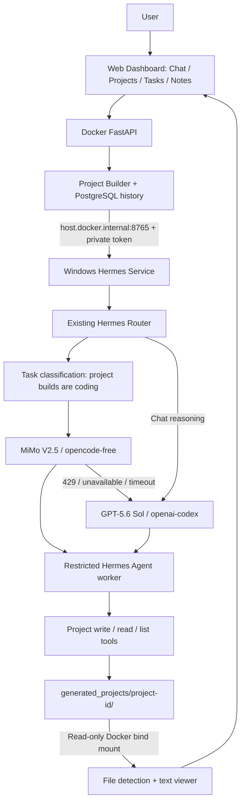

# Hermes AI Project Builder

Phase 1 extends the existing AI Personal Assistant with real project creation.
Chat, Tasks, Notes, PostgreSQL, Docker, Ollama, and the existing Hermes router remain.
Describe a development task in **Projects**, then inspect the files Hermes actually
wrote. Project history survives backend restarts in PostgreSQL.

## Project Builder architecture



The Windows service runs `hermes_project_worker.py` using the Python environment
of the installed Hermes Agent. This worker uses the real `AIAgent` conversation
loop and existing Hermes provider authentication. It must call `project_write_file`
to create files. An answer containing code or a claimed file list is insufficient.
`hermes_router.route_prompt` supplies the model/provider and controls fallback;
there is no second routing table. Normal chat still uses the original Hermes CLI.

## Start the complete system (PowerShell)

Run in the repository directory. Your existing `.env` must be preserved:

```powershell
if (!(Test-Path .env)) { Copy-Item .env.example .env }
if (!(Test-Path .venv)) { py -m venv .venv }
.\.venv\Scripts\python.exe -m pip install -r requirements.txt
```

The implementation session configured `PROJECT_BUILDER_TOKEN` in your local
`.env`. For a fresh checkout, generate one without printing it:

```powershell
.\.venv\Scripts\python.exe -c "from dotenv import dotenv_values, set_key; import secrets; v=dotenv_values('.env'); set_key('.env', 'PROJECT_BUILDER_TOKEN', v.get('PROJECT_BUILDER_TOKEN') or secrets.token_urlsafe(48))"
```

The same `.env` is loaded by Compose and `hermes_service.py`. Tokens must have at
least 32 characters. No token is sent to the browser. Use your configured database
password; do not overwrite existing PostgreSQL settings or remove its volume.

In the first terminal, stop any **old** host service with Ctrl+C, then start it:

```powershell
.\.venv\Scripts\python.exe hermes_service.py
```

The worker defaults to
`%LOCALAPPDATA%/hermes/hermes-agent/venv/Scripts/python.exe`, which matches the
inspected installation. For another installation, set `HERMES_PYTHON` in `.env`
to the full path of its Python executable. Do not point this at Docker Python.
The installed Hermes environment must provide `run_agent.AIAgent` and
`hermes_cli.runtime_provider.resolve_runtime_provider`.

In a second terminal:

```powershell
docker compose up --build -d
docker compose ps
Invoke-RestMethod http://localhost:8765/health
Start-Process 'http://localhost:8000/static/index.html'
```

Open **Projects**, enter “Create a responsive website for a coffee shop”, and click
**Build Project**. Both primary and fallback attempts can take up to 300 seconds
each; the backend HTTP timeout defaults to 620 seconds. Change both timeout
settings together if longer builds are required, and restart both services.

## Workspace, history, and API

Each build receives a server-generated 32-character UUID directory:

```text
generated_projects/
    <project-id>/
        index.html
        css/style.css
        script.js
```

Names above are examples. The API scans the real directory and reports only
existing, validated files. The project display name is a slug derived from the
prompt, while the filesystem uses only the UUID. Failed attempts can leave partial
files for inspection. Fallback may inspect and complete those same files.

| Endpoint | Purpose |
|---|---|
| `POST /api/projects` | Build from `{"prompt":"Create a coffee shop website"}` |
| `GET /api/projects?limit=50&offset=0` | Paginated PostgreSQL history |
| `GET /api/projects/{project_id}` | Metadata and actual current file list |
| `GET /api/projects/{project_id}/files` | Actual current file list |
| `GET /api/projects/{project_id}/file?path=css/style.css` | Validated UTF-8 text as JSON |
| Host `POST /projects/build` | Internal authenticated Windows execution endpoint |

Responses include `success`, `project_id`, `project_name`, `task_type`, `model`,
`provider`, `fallback_used`, `status`, `created_at`, `message`, and (for build/detail)
`files`. A POST returns HTTP 201 when the history record is created; inspect
`success` and `status` to determine build success. Validation/configuration errors
use 4xx/503 responses. A host HTTP timeout records `unknown`, because the worker
may still finish; inspect host logs before retrying.

The additive `projects` table contains id, name, original_prompt, task_type, model,
provider, fallback_used, status, message, and created_at. Existing startup
`Base.metadata.create_all()` creates it without dropping or changing conversations,
tasks, or notes. There is no new migration dependency.

## Phase 1 security and limitations

- The agent has only three project file tools. The entire tool execution dispatcher
  is replaced, denying terminal, arbitrary filesystem, browser, delegation, and
  code-execution calls even if the model invents them. Project rules, memories,
  context files, and project plugins are not loaded. Generated code is never run.
- The workspace root is fixed by application code. Prompts cannot set it. UUIDs,
  filenames, and every path component are validated. Traversal, absolute/drive/UNC
  paths, backslashes, alternate data streams, hidden files, reserved Windows device
  names, symbolic links, junctions/reparse points, and hard links are rejected.
- Only allowlisted UTF-8 text extensions are supported. Limits: 100 files, 512,000
  bytes per file, 5,000,000 bytes per project, 10 path components, 12,000 prompt
  characters, 40 agent iterations, and two concurrent host builds. Credential-like
  filenames are rejected. The agent cannot read application `.env`, host user files,
  or Hermes credentials through its tools. Avoid supplying secrets in prompts.
- Docker mounts only `generated_projects` for project viewing, read-only. HTML,
  JavaScript, and SVG are returned as JSON and displayed with `textContent`.
  Generated projects are excluded from Git and Docker image contents.
- **Website preview is pending.** `preview_available` is false; `preview_pending`
  identifies an existing `index.html`. No generated static directory is mounted
  as a web server. Future preview requires an isolated origin and restrictive sandbox.
- This is an application-level tool boundary, not an OS sandbox for untrusted
  Python or protection against a malicious local administrator modifying directories
  concurrently. Hermes and its installed provider/runtime code remain trusted.
  Do not give other processes write access to the generated workspace during builds.
- The existing dashboard and chat service remain single-user and unauthenticated;
  restrict backend/host ports to your local trusted environment. The new host build
  endpoint requires the shared token. It never logs that token, prompts, or raw
  provider output. Existing `/route` authentication behavior is unchanged.
- Builds are synchronous and not a durable job queue. Closing the browser does not
  cancel a build. Crashes may leave a `building` record; HTTP timeouts may leave
  `unknown`. There is no automatic recovery, deletion, download, install, or execution.
  History shows the latest 50 projects in the UI; the API supports pagination.
- Hermes internal Python APIs can change; rerun compatibility checks after updates.
  Live provider behavior and generated project quality require a real Hermes demo.

## Offline tests and university demonstration

No extra test dependency, production database writes, or paid calls are needed:

```powershell
.\.venv\Scripts\python.exe -m unittest discover -s tests -v
.\.venv\Scripts\python.exe -m compileall -q app hermes_router.py hermes_service.py hermes_projects.py hermes_project_worker.py
node --check app/static/projects.js
node tests/frontend_projects.test.cjs
& "$env:LOCALAPPDATA\hermes\hermes-agent\venv\Scripts\python.exe" -I tests/check_hermes_worker.py
```

Tests exercise real FastAPI ASGI routes using isolated SQLite and temporary
workspaces, with only host/provider calls mocked. Coverage includes creation,
history, file list/read, traversal, host authentication, text/size restrictions,
link rejection, actual restricted tool dispatch, fallback/429/timeout errors, model
metadata, `/api/converse`, Tasks, Notes, and the retained Ollama adapter. The symlink
test skips when Windows does not grant permission to create links.
The Node DOM harness verifies submit/history/file-viewer flows and inert HTML
rendering; it is not a visual browser test. The optional installed-Hermes smoke
test constructs a real agent with a temporary profile, mocks its model turn, and
blocks socket connections. An attempted model-metadata lookup may report that
network access was intentionally disabled.

For a presentation:

1. Show the diagram and explain Docker-to-Windows routing and the three restricted tools.
2. Open Projects and build a coffee shop website. This step makes real provider calls.
3. Show the host logs: coding, MiMo/OpenCode, optional fallback, and files detected.
4. Show the real directory, click files in the viewer, and explain why HTML stays text.
5. Refresh history to demonstrate PostgreSQL persistence and actual model metadata.
6. Show Chat, a Task, and a Note to demonstrate retained functionality.
7. Run the offline suite to demonstrate forced HTTP 429 fallback safely without
   changing provider credentials. Do not claim a real fallback unless it happened.

Optional real build API command (uses your configured providers):

```powershell
$body = @{ prompt = 'Create a responsive website for a coffee shop' } | ConvertTo-Json
Invoke-RestMethod -Method Post -Uri http://localhost:8000/api/projects -ContentType 'application/json' -Body $body
docker compose logs --tail=50 backend
```

## Existing assistant documentation

A Dockerized personal assistant with a browser UI, FastAPI, PostgreSQL, Tasks,
Notes, a Windows-host Hermes Agent multi-model router, and retained Ollama local
model support.

## Architecture

```text
Browser
  |
  | POST /api/converse
  v
FastAPI backend (Docker) -----------------> PostgreSQL 15 (Docker)
  |
  | http://host.docker.internal:8765/route
  v
Hermes router service (Windows host)
  |
  +-- task classifier
  |     +-- coding
  |     `-- reasoning/general
  |
  +-- coding: mimo-v2.5-free / opencode-free
  |       `-- automatic fallback on 429 or provider failure
  |           gpt-5.6-sol / openai-codex
  |
  `-- reasoning: gpt-5.6-sol / openai-codex
          |
          v
      Hermes Agent CLI
```

The browser never calls the host router directly. It keeps using the existing
FastAPI backend. Conversation messages and replies are stored in PostgreSQL;
Tasks and Notes retain their existing database-backed endpoints.

Ollama is still supported. Set `AI_PROVIDER=ollama` to use the original
Docker-to-Windows Ollama path instead of Hermes.

## Model routing

`hermes_router.py` classifies only the current user prompt. Coding terms include
common languages, frameworks, web-development terms, debugging, APIs, databases,
Docker, and English/Arabic creation phrases. Prompts without a coding match are
treated as reasoning/general tasks.

| Task type | Primary model | Provider | Fallback |
|---|---|---|---|
| Coding | `mimo-v2.5-free` | `opencode-free` | `gpt-5.6-sol` / `openai-codex` |
| Reasoning/general | `gpt-5.6-sol` | `openai-codex` | None |

Hermes is invoked on Windows as an argument list, without a shell:

```text
hermes -z "PROMPT" --model MODEL --provider PROVIDER
```

A non-zero exit, HTTP/provider error text, rate limit, timeout, connection error,
or empty output counts as failure. For coding tasks, the router automatically
tries GPT-5.6 Sol after a MiMo failure, including HTTP 429. It never returns a
hardcoded AI answer.

The host console provides presentation-friendly logs such as:

```text
Task type: coding
Selected model: mimo-v2.5-free
Provider: opencode-free
Primary model failed: HTTP 429
Activating fallback
Selected model: gpt-5.6-sol
Provider: openai-codex
```

Raw failed-provider output is not returned to the browser and is not written to
application logs, reducing the chance of exposing tokens or credentials.

## Project structure

```text
AI-Personal-Assistant/
|-- app/
|   |-- ai.py                    # Hermes HTTP client and retained Ollama adapter
|   |-- crud.py                  # Conversation, Task, and Note database operations
|   |-- database.py              # PostgreSQL connection and startup retry
|   |-- main.py                  # Docker FastAPI application
|   |-- models.py
|   |-- schemas.py
|   |-- routers/
|   |   |-- conversation.py      # Existing /api/converse, now routed to Hermes
|   |   |-- tasks.py
|   |   `-- notes.py
|   `-- static/index.html        # Existing browser frontend
|-- hermes_router.py             # Classifier, model selection, CLI execution, fallback
|-- hermes_service.py            # Windows-host FastAPI /route service
|-- compose.yaml
|-- Dockerfile
|-- requirements.txt
`-- .env.example
```

## Configuration

Create the local configuration file once:

```powershell
if (!(Test-Path .env)) { Copy-Item .env.example .env }
```

Relevant values are:

```dotenv
AI_PROVIDER=hermes
HERMES_ROUTER_URL=http://host.docker.internal:8765
HERMES_ROUTER_TIMEOUT=620
HERMES_COMMAND_TIMEOUT=300
HERMES_PROJECT_WORKER_TIMEOUT=900
HERMES_ROUTER_PORT=8765

OLLAMA_BASE_URL=http://host.docker.internal:11434
OLLAMA_MODEL=llama3.2:3b

POSTGRES_USER=assistant
POSTGRES_PASSWORD=replace-this-value
POSTGRES_DB=assistantdb
BACKEND_PORT=8000
```

`HERMES_COMMAND_TIMEOUT` configures normal Hermes chat commands. The
Project Builder worker uses its dedicated `HERMES_PROJECT_WORKER_TIMEOUT`
setting, defaulting to 900 seconds, while `HERMES_ROUTER_PORT` configures the
Windows host process. `HERMES_ROUTER_TIMEOUT` configures the Docker backend
and is longer because one coding request may make both primary and fallback
attempts.

Never commit `.env`, API keys, OAuth credentials, tokens, or real passwords.
The project ignores `.env` in both Git and the Docker build context.

## Run on Windows

Prerequisites are Docker Desktop, a working `hermes` command on the Windows host,
and Python. The pinned project requirements already contain FastAPI and Uvicorn.

Open PowerShell in the project directory. Install dependencies into a virtual
environment if they are not already available:

```powershell
py -m venv .venv
.\.venv\Scripts\Activate.ps1
python -m pip install -r requirements.txt
```

Verify Hermes in that same shell, then start the host router:

```powershell
hermes --help
python hermes_service.py
```

Leave that PowerShell window open. The service listens on port 8765 and must run
on Windows, not in Docker. If Windows Firewall prompts for access, allow the
private Docker Desktop network only as appropriate for your machine.

In a second PowerShell window, start the existing application:

```powershell
if (!(Test-Path .env)) { Copy-Item .env.example .env }
# Edit .env and replace the example database password.
docker compose up --build -d
docker compose ps
```

Open:

```text
http://localhost:8000/static/index.html
```

## API endpoints

### Windows host router

- `GET http://localhost:8765/health`
- `POST http://localhost:8765/route`
- `GET http://localhost:8765/docs`

Minimal request:

```json
{
  "prompt": "Create a website for a travel company"
}
```

Successful response shape:

```json
{
  "success": true,
  "task_type": "coding",
  "model": "gpt-5.6-sol",
  "provider": "openai-codex",
  "fallback_used": true,
  "response": "...",
  "error": null
}
```

The endpoint also accepts an optional `history` array. The Docker backend sends
up to 20 existing conversation messages for context.

### Docker backend

- `GET /`
- `POST /api/converse`
- `GET /api/conversations`
- `GET`, `POST /api/tasks`
- `POST /api/tasks/{id}/done`
- `DELETE /api/tasks/{id}`
- `GET`, `POST /api/notes`
- `DELETE /api/notes/{id}`
- `GET /docs`

`POST /api/converse` keeps `reply` for frontend compatibility and adds routing
metadata (`task_type`, `model`, `provider`, and `fallback_used`) for diagnostics.

## Testing

Test host health:

```powershell
Invoke-RestMethod http://localhost:8765/health
```

Test coding classification and real Hermes execution directly:

```powershell
$body = @{ prompt = 'Create a website for a travel company' } | ConvertTo-Json
Invoke-RestMethod -Method Post -Uri http://localhost:8765/route -ContentType 'application/json' -Body $body
```

Test reasoning routing:

```powershell
$body = @{ prompt = 'Explain why the sky appears blue' } | ConvertTo-Json
Invoke-RestMethod -Method Post -Uri http://localhost:8765/route -ContentType 'application/json' -Body $body
```

Test Docker-to-host connectivity:

```powershell
docker compose exec backend python -c "import requests; print(requests.get('http://host.docker.internal:8765/health', timeout=10).json())"
```

Test the complete browser/backend route:

```powershell
$body = @{ message = 'Create a Python function that adds two numbers' } | ConvertTo-Json
Invoke-RestMethod -Method Post -Uri http://localhost:8000/api/converse -ContentType 'application/json' -Body $body
```

Watch the presentation logs in the host-router PowerShell window. Backend logs
are available with:

```powershell
docker compose logs -f backend
```

MiMo fallback is naturally demonstrated when MiMo returns 429. Do not intentionally
invalidate or expose credentials to force an error.

## Ollama local-model option

The original Ollama adapter remains in `app/ai.py`. To select it, edit `.env`:

```dotenv
AI_PROVIDER=ollama
OLLAMA_BASE_URL=http://host.docker.internal:11434
OLLAMA_MODEL=llama3.2:3b
```

Start Ollama on Windows and recreate the backend so it receives the changed
environment:

```powershell
ollama list
docker compose up --build -d --force-recreate backend
```

Switch `AI_PROVIDER` back to `hermes` and recreate the backend to restore the
multi-model path.

## Error handling and limitations

- Each Hermes CLI attempt defaults to 300 seconds. A coding request can take two
  attempts when fallback is required.
- Calls are synchronous and non-streaming.
- The keyword classifier is deterministic and intentionally simple; ambiguous
  prompts may be classified as reasoning.
- Reasoning uses GPT-5.6 Sol directly and has no second configured fallback.
- The host service depends on the Windows account's working Hermes installation,
  provider configuration, network access, and PATH.
- Binding to `0.0.0.0` is required for Docker Desktop access. The service has no
  authentication, so keep port 8765 restricted to trusted local/private networks.
- PostgreSQL conversation history is global; there is no user authentication or
  per-user isolation.
- If the host service is stopped, Hermes chat returns a clear 503 error. Tasks,
  Notes, PostgreSQL, and the Ollama option remain available.

## Static website validation (autonomous-agent Phase 1)

The safe validation foundation is implemented as an authenticated backend/host
operation with a fixed, network-disabled Docker parser. It never executes generated
JavaScript or package scripts. See [the validation guide](docs/VALIDATION_FOUNDATION.md)
for image setup, API usage, security controls, test results, limitations, and the
Phase 2 approval boundary.

## Bounded repairs (autonomous-agent Phase 2)

Existing managed static websites can be repaired through the backend repair API.
The loop validates a protected baseline, permits at most three restricted Hermes
repair turns, and requires a trusted final validation pass. See the
[Phase 2 guide](docs/BOUNDED_REPAIR_PHASE2.md) for API usage, cancellation, limits,
checkpoints, offline tests and remaining release gates.

## Durable repair runs (autonomous-agent Phase 3)

The durable run APIs persist queued work, ordered events, model attempts and
validation results in PostgreSQL. The Windows bridge claims jobs with renewable
leases and preserves project protection after uncertain cleanup. See the
[Phase 3 operating guide](docs/DURABLE_RUNS_PHASE3.md) for migrations, submission,
persistent cancellation, recovery, checkpoint retention and test results.

## Autonomous run monitor (Phase 4)

Existing projects now offer Validate, Fix Project and View Runs. The monitor reads
persisted stages/events, shows structured validation errors and changed files, and
supports cancellation and fresh retries. See the [Phase 4 guide](docs/RUN_MONITOR_PHASE4.md)
for polling behavior, security, offline screenshots and tests. Live provider testing
remains a separately approved release gate.

## Live provider acceptance (Phase 5)

The single approved live Hermes/Codex repair acceptance test passed: one repair,
two durable validations, an actual script.js edit, and confirmed cleanup. See the
[Phase 5 report](docs/LIVE_ACCEPTANCE_PHASE5.md) for the preserved run, timestamps,
safe diagnostics and real UI screenshot. This was one bounded acceptance run;
further provider tests and cloud integration require separate approval.

## Troubleshooting

If Docker cannot reach Hermes, confirm the Windows service is running, check
`http://localhost:8765/health`, then run the Docker-to-host test above. Use
`host.docker.internal`, never `localhost`, from inside the backend container.

If `hermes` is not found, start the host service from the same PowerShell profile
where `hermes -z "test" --model gpt-5.6-sol --provider openai-codex` works.

If the backend still uses an old provider setting, recreate it:

```powershell
docker compose up --build -d --force-recreate backend
```

Safe static publication is documented in [Phase 6 offline readiness](docs/PUBLICATION_PHASE6.md).
GitHub publication remains disabled until the first cloud acceptance test is explicitly approved.

Stop containers without deleting PostgreSQL data:

```powershell
docker compose down
```
