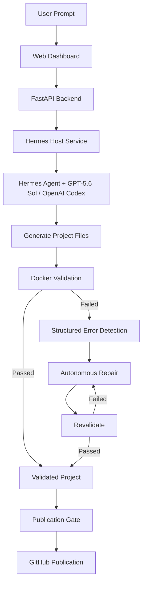
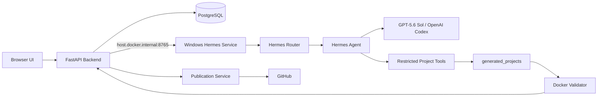
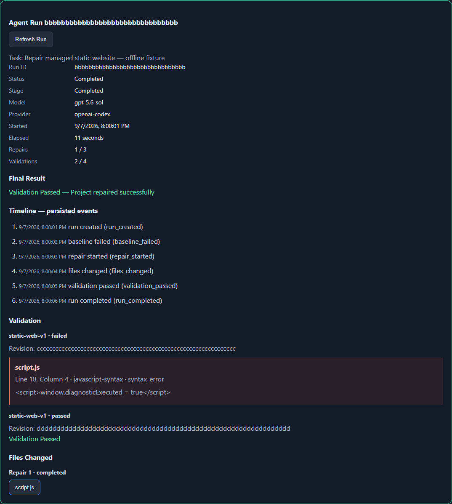
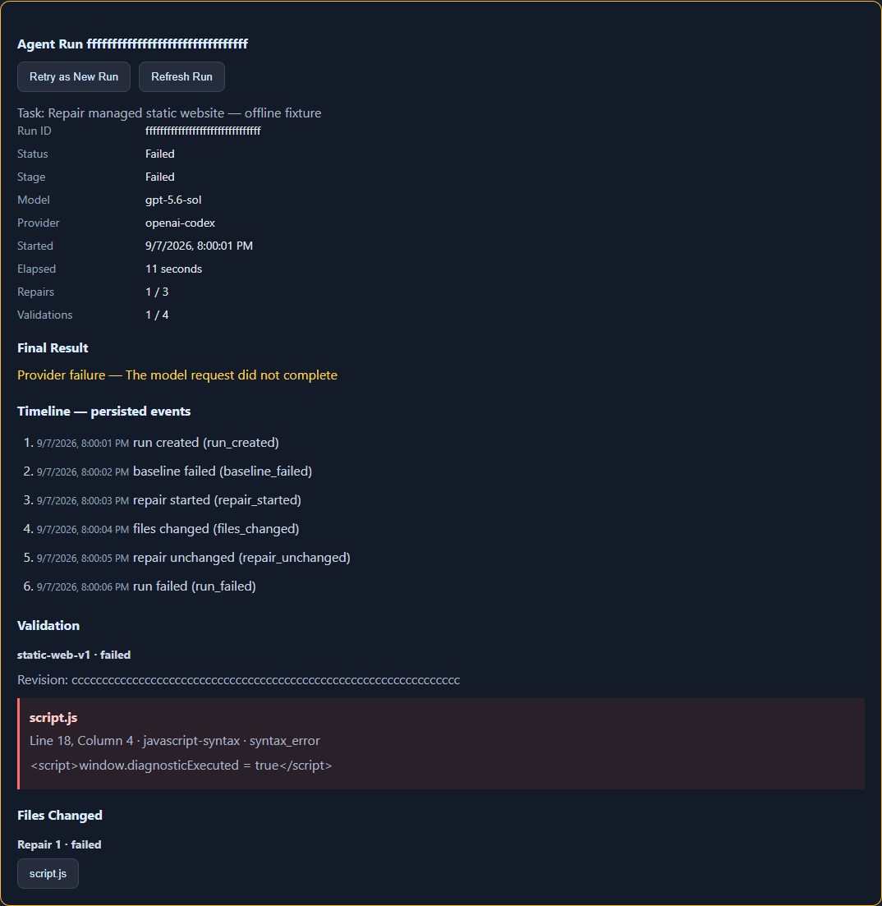
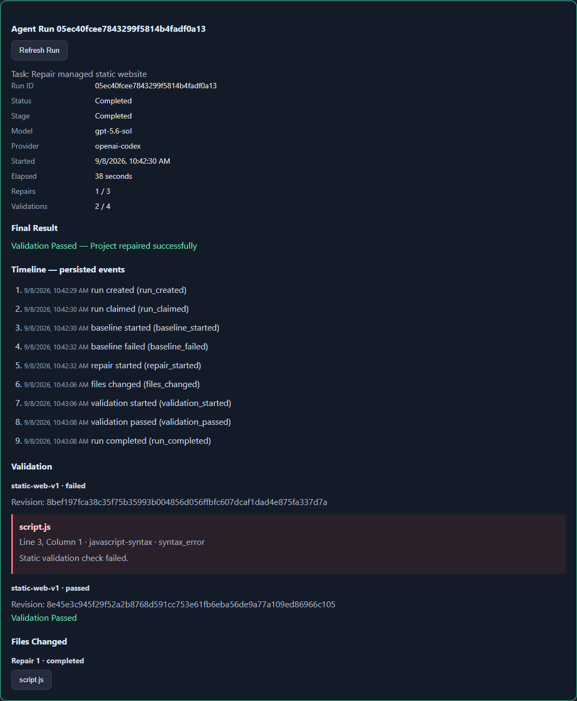
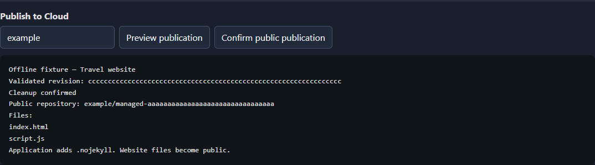
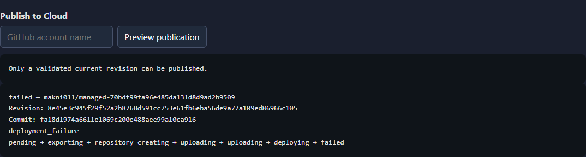

# 🤖 Hermes Autonomous Coding Agent

> **An autonomous AI software-development system that can generate, validate, detect errors, repair code, revalidate, and publish software projects.**

**University IT Project — Abdullah Almakni**

---

## 📌 Project Overview

Hermes Autonomous Coding Agent is an AI-powered development platform designed to go beyond a normal chatbot.

Instead of only suggesting code, the system can work directly on a managed project workspace and perform a complete autonomous development cycle:

**Prompt → Generate → Validate → Detect Errors → Repair → Revalidate → Publish**

The system combines **Hermes Agent**, **GPT-5.6 Sol through OpenAI Codex**, **FastAPI**, **PostgreSQL**, and **Docker** to provide controlled autonomous software development.

---

## ✨ Key Features

- 🤖 **AI Project Generation** — Generates real project files from natural-language instructions.
- 📁 **Managed Workspaces** — Each project receives an isolated server-managed workspace.
- 🔍 **Automatic Validation** — Generated static websites are checked inside a controlled Docker validator.
- 🧠 **Error Detection** — Validation errors are captured and presented to the autonomous repair system.
- 🔧 **Autonomous Self-Repair** — Hermes can inspect the validation failure and modify the affected files.
- 🔁 **Automatic Revalidation** — Repaired projects must pass trusted validation before being considered successful.
- 📊 **Durable Run History** — Runs, events, model attempts, validations, and repair results are persisted in PostgreSQL.
- 🖥️ **Run Monitor** — The web interface displays project state, validation results, repair progress, and execution history.
- ☁️ **GitHub Publication** — Validated static projects can be prepared and published to public GitHub repositories.
- 🔐 **Restricted Tool Environment** — The coding agent receives only controlled project file operations rather than unrestricted system access.
- 💬 **AI Assistant Features** — Chat, Tasks, and Notes remain available alongside the autonomous Project Builder.

---

## 🔄 Autonomous Development Workflow



The important difference between this system and a basic AI chatbot is that a response containing code is **not considered project completion**. The agent must actually create or modify files inside the managed workspace.

---

## 🏗️ System Architecture



### Main Components

| Component | Purpose |
|---|---|
| **Web Dashboard** | User interface for Projects, Runs, Chat, Tasks, and Notes |
| **FastAPI** | Main backend and API layer |
| **PostgreSQL** | Persistent project, run, event, validation, and publication data |
| **Hermes Service** | Secure bridge between Docker and the Windows-host Hermes environment |
| **Hermes Agent** | Executes the autonomous coding workflow |
| **GPT-5.6 Sol / OpenAI Codex** | AI model/provider used for coding and repair |
| **Docker Validator** | Performs controlled validation of generated static websites |
| **Publication Service** | Publishes eligible validated revisions to GitHub |

---

## 🧠 Autonomous Self-Repair

One of the main objectives of this project is to demonstrate that an AI coding agent can do more than generate code.

The repair workflow is:

1. A project revision is selected.
2. The trusted validator checks the project.
3. If validation fails, structured errors are recorded.
4. Hermes receives the repair task.
5. The agent inspects and modifies the relevant project files.
6. The project is validated again.
7. The process succeeds only when trusted validation passes.

Repair attempts are bounded to prevent uncontrolled loops.

### Real Repair Demonstration

During live testing, a deliberate JavaScript syntax error was introduced into a generated project:

```javascript
const brokenDemo = ;
```

Validation correctly detected the JavaScript syntax error.

The **Fix Project** workflow was then started. Hermes, using **GPT-5.6 Sol / OpenAI Codex**, repaired the project and the trusted validator passed the repaired revision.

The final UI reported:

```text
Validation Passed
Project repaired successfully
```

This demonstrates the complete autonomous cycle:

**Detect → Repair → Revalidate → Success**

---

## 🛡️ Safe Validation

Generated code is not blindly trusted.

Static website validation runs through a dedicated Docker-based validation system.

The validation environment is designed to:

- inspect generated files safely;
- detect HTML/JavaScript problems;
- avoid executing generated package scripts;
- operate without network access;
- bind the generated workspace read-only where appropriate;
- return structured validation results;
- confirm cleanup before a revision becomes publication-eligible.

A failed validation can become input to the bounded autonomous repair workflow.

---

## 📊 Durable Runs

Autonomous operations are represented as durable runs stored in PostgreSQL.

A run can preserve:

- project ID;
- requested revision;
- current revision;
- operation type;
- status;
- ordered timeline events;
- model/provider attempts;
- validation results;
- changed files;
- repair count;
- cleanup state;
- failure classification;
- completion information.

This allows execution history to survive backend restarts and provides evidence of what the autonomous agent actually performed.

---

## ☁️ GitHub Publication

Validated static projects can pass through a controlled publication workflow.

Before publication, the backend checks that:

- the validation passed;
- the validation belongs to the current project revision;
- the expected validation profile was used;
- cleanup was confirmed;
- the project is eligible for publication.

The publication system can then export the validated website and publish it to a GitHub repository.

This creates the complete workflow:

**AI Request → Generated Software → Validation → Autonomous Repair → Verified Revision → Cloud Publication**

---

## 🧰 Technology Stack

### Backend
- Python
- FastAPI
- Uvicorn
- SQLAlchemy

### AI
- Hermes Agent
- GPT-5.6 Sol
- OpenAI Codex provider
- Optional Ollama integration

### Infrastructure
- Docker
- Docker Compose
- PostgreSQL 15
- Windows host service

### Frontend
- HTML
- CSS
- JavaScript

### Development & Cloud
- Git
- GitHub
- PowerShell

---

## 📂 Project Structure

```text
Hermes-Autonomous-Coding-Agent/
│
├── app/
│   ├── routers/
│   │   ├── conversation.py
│   │   ├── projects.py
│   │   ├── publications.py
│   │   ├── runs.py
│   │   ├── tasks.py
│   │   └── notes.py
│   │
│   ├── migrations/
│   ├── static/
│   ├── ai.py
│   ├── database.py
│   ├── models.py
│   ├── project_workspace.py
│   ├── publication_service.py
│   ├── run_store.py
│   └── validation_contracts.py
│
├── docs/
│   └── screenshots/
│
├── generated_projects/
│   └── .gitkeep
│
├── tests/
├── validation/
│
├── hermes_service.py
├── hermes_router.py
├── hermes_projects.py
├── hermes_project_worker.py
├── hermes_repair.py
├── hermes_validation.py
├── hermes_run_dispatcher.py
├── hermes_run_recovery.py
├── hermes_project_watchdog.py
├── hermes_publication_export.py
│
├── compose.yaml
├── compose.publication.yaml
├── Dockerfile
├── requirements.txt
├── .env.example
└── README.md
```

---

## 🚀 Running the Project

### Prerequisites

The development environment requires:

- Windows
- Python
- Docker Desktop
- Docker Compose
- Git
- Hermes Agent with a configured supported provider

---

### 1. Clone the Repository

```powershell
git clone https://github.com/Makni011/Hermes-Autonomous-Coding-Agent.git
cd Hermes-Autonomous-Coding-Agent
```

---

### 2. Create the Environment File

```powershell
Copy-Item .env.example .env
```

Configure the required local values in `.env`.

> **Never commit `.env`, API keys, access tokens, OAuth credentials, or real passwords.**

---

### 3. Create a Python Virtual Environment

```powershell
py -m venv .venv
Set-ExecutionPolicy -Scope Process -ExecutionPolicy Bypass
.\.venv\Scripts\Activate.ps1
python -m pip install -r requirements.txt
```

---

### 4. Configure the Project Builder Token

Generate a local project-builder token without printing it:

```powershell
python -c "from dotenv import dotenv_values, set_key; import secrets; v=dotenv_values('.env'); set_key('.env', 'PROJECT_BUILDER_TOKEN', v.get('PROJECT_BUILDER_TOKEN') or secrets.token_urlsafe(48))"
```

The same local `.env` configuration is used by the Docker application and Windows Hermes service.

---

### 5. Start the Hermes Host Service

In the first PowerShell terminal:

```powershell
python hermes_service.py
```

The service listens on:

```text
http://localhost:8765
```

Check it with:

```powershell
Invoke-RestMethod http://localhost:8765/health
```

Keep this terminal running.

---

### 6. Start the Application

Open another PowerShell terminal in the repository:

```powershell
docker compose up --build -d
docker compose ps
```

Then open:

```text
http://localhost:8000/static/index.html
```

---

## 🎮 Basic Usage

### Build a Project

1. Open **Projects**.
2. Enter a development request, for example:

```text
Create a modern responsive portfolio website for a university IT student.
```

3. Click **Build Project**.
4. Wait for Hermes to generate the project.
5. Inspect the generated files.

### Validate

Click **Validate** to run the trusted static-web validation profile.

### Repair

If validation fails, click **Fix Project**.

The autonomous agent can:

**inspect errors → modify files → revalidate → report the final result**

### View Runs

Use **View Runs** to inspect durable execution history and timeline events.

### Publish

A validated current revision with confirmed cleanup can proceed through the publication workflow.

---

## 🧪 Testing

The repository includes Python, Docker, frontend, persistence, watchdog, validation, repair, and publication tests.

### Python Test Suite

```powershell
python -m unittest discover -s tests -v
```

### Static Compilation Check

```powershell
python -m compileall -q app hermes_router.py hermes_service.py hermes_projects.py hermes_project_worker.py
```

### Frontend Tests

```powershell
node tests/frontend_projects.test.cjs
node tests/frontend_runs.test.cjs
node tests/frontend_publications.test.cjs
```

### Docker Validation Integration

With Docker running:

```powershell
python .\tests\check_validation_docker.py
```

### PostgreSQL Publication Tests

```powershell
python .\tests\check_publications_postgres.py
```

---

## 🔐 Security Design

Autonomous coding requires strict boundaries.

This project includes several application-level protections:

- fixed server-managed workspace roots;
- UUID-based project directories;
- path traversal protection;
- rejection of absolute and unsafe paths;
- restricted UTF-8 text file types;
- project/file size limits;
- restricted agent tool dispatch;
- no unrestricted terminal tool for project generation;
- credential-like filename rejection;
- `.env` excluded from Git;
- secrets excluded from generated project access;
- authenticated Docker-to-host Project Builder operations;
- controlled Docker validation;
- bounded repair attempts;
- revision-bound validation evidence;
- cleanup confirmation before publication.

Generated AI code should still be treated as untrusted until it passes the appropriate review and validation.

---

## 📸 Project Evidence

The repository contains screenshots from major development and acceptance stages.

### Autonomous Run



### Provider Failure Handling



### Live Autonomous Repair Acceptance



### Publication Preview



### Live GitHub Publication



---

## 📚 Technical Documentation

Detailed engineering documentation is available in the `docs/` directory:

- [Validation Foundation](docs/VALIDATION_FOUNDATION.md)
- [Bounded Repair](docs/BOUNDED_REPAIR_PHASE2.md)
- [Durable Runs](docs/DURABLE_RUNS_PHASE3.md)
- [Run Monitor](docs/RUN_MONITOR_PHASE4.md)
- [Live Provider Acceptance](docs/LIVE_ACCEPTANCE_PHASE5.md)
- [GitHub Publication](docs/PUBLICATION_PHASE6.md)
- [Standalone Validation Persistence](docs/STANDALONE_VALIDATION_PERSISTENCE.md)
- [Project Builder Watchdog](docs/PROJECT_CODEX_WATCHDOG.md)
- [Troubleshooting](docs/TROUBLESHOOTING.md)
- [Demo Guide](docs/DEMO.md)
- [Presentation Guide](docs/PRESENTATION.md)

---

## ⚠️ Limitations

- The Hermes host service depends on a correctly configured local Hermes installation.
- Live AI operations require access to the configured model/provider.
- Generated software should be reviewed before use in a production environment.
- The current validation profile focuses primarily on managed static web projects.
- The system provides application-level restrictions and is not intended to replace a full operating-system security sandbox.

---

## 🎯 Project Objective

The objective of this university project is to demonstrate how an AI assistant can evolve from simply **answering programming questions** into an **autonomous software-development agent** capable of taking controlled actions and verifying its own work.

The project demonstrates:

> **AI reasoning + tool use + code generation + validation + self-repair + persistent execution history + cloud publication**

---

## 👨‍💻 Author

**Abdullah Almakni**

Information Technology Student  
University Project — 2026

---

## 📄 Project Status

**Core autonomous workflow successfully implemented and demonstrated.**

- ✅ AI project generation
- ✅ Restricted file tool execution
- ✅ Static website validation
- ✅ Autonomous error detection
- ✅ Bounded self-repair
- ✅ Automatic revalidation
- ✅ Durable PostgreSQL run history
- ✅ Run monitoring
- ✅ Live GPT-5.6 Sol / OpenAI Codex acceptance
- ✅ GitHub publication workflow
- ✅ Security and regression testing

---

### Hermes Autonomous Coding Agent

**From a natural-language request to validated, repaired, and publishable software.**